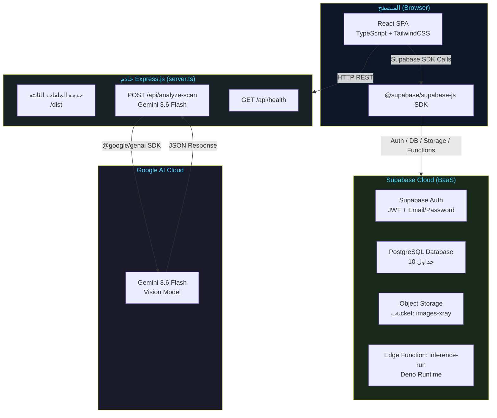
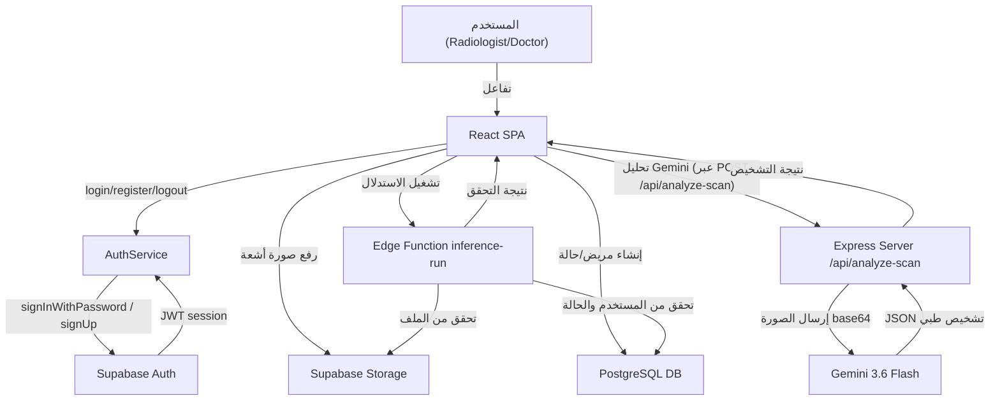
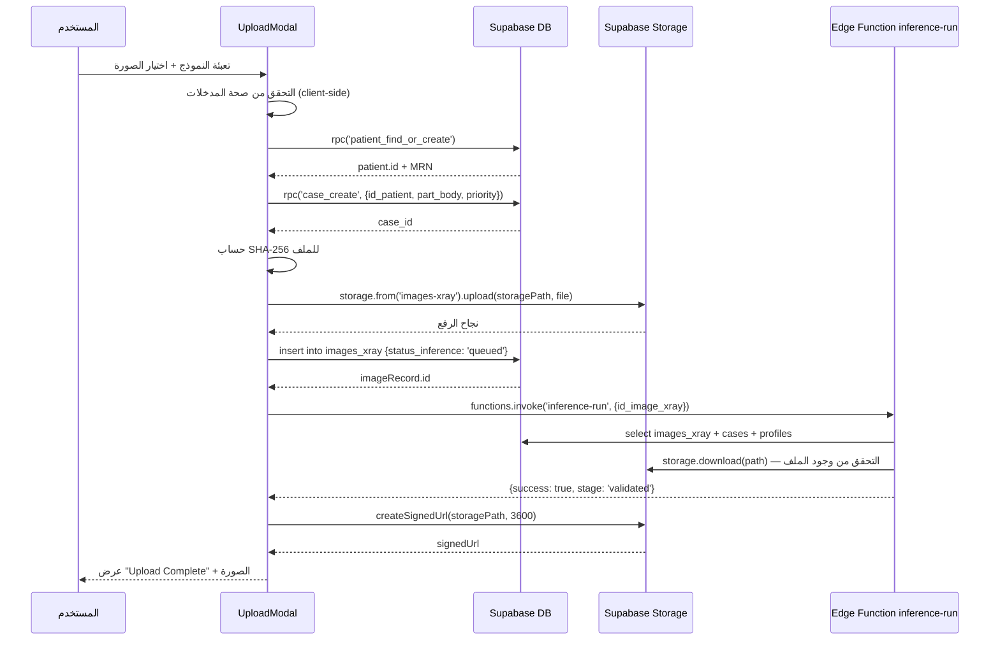
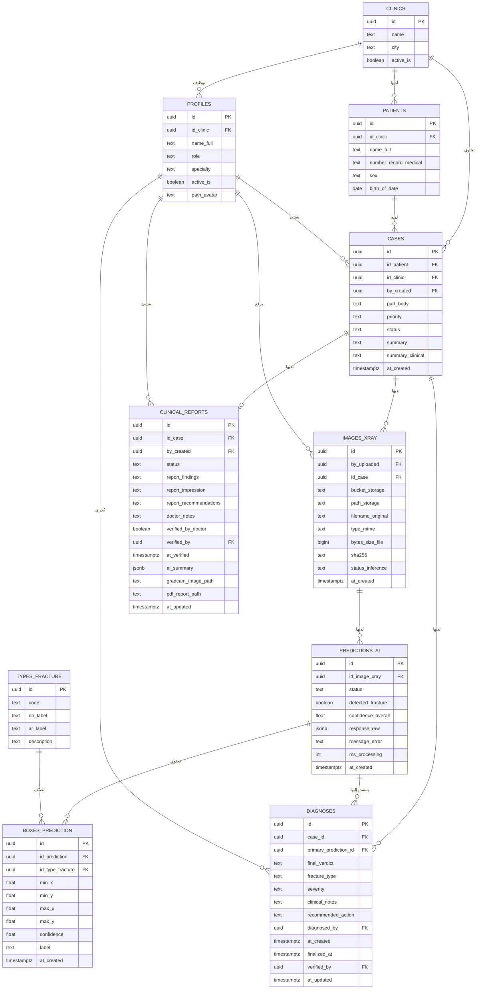
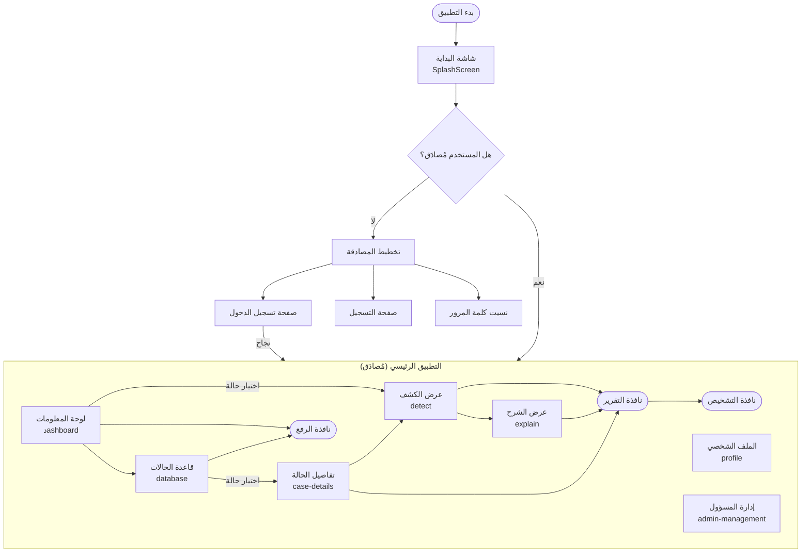
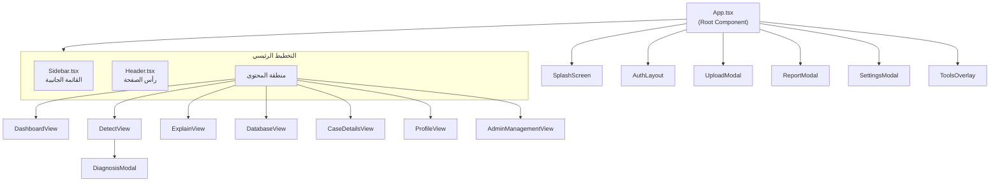
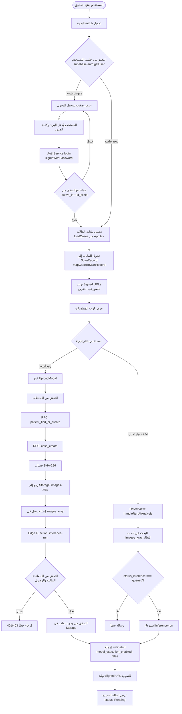
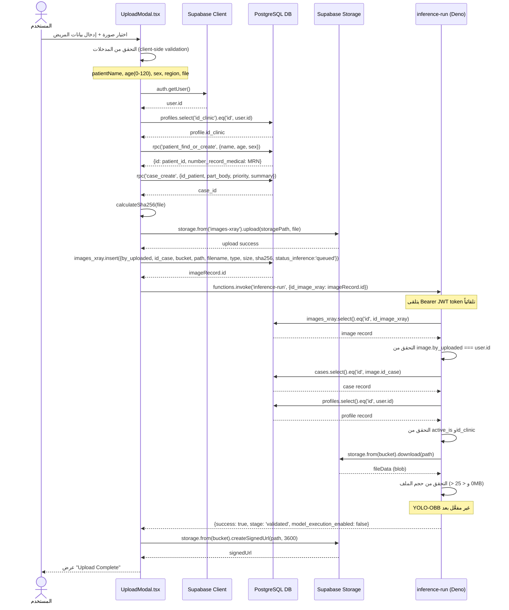
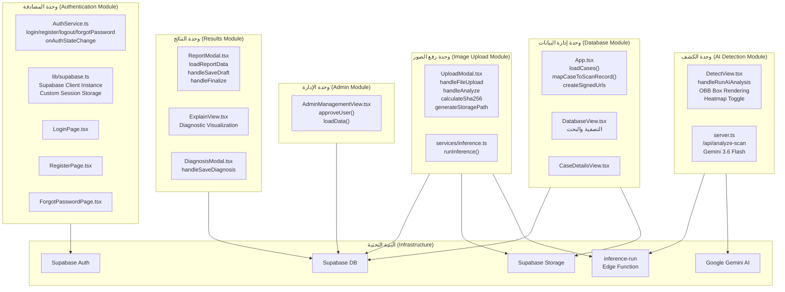

# تحليل الفصل الرابع — تصميم النظام
## نظام كشف كسور العظام بالذكاء الاصطناعي (FractureAI Pro)
### وثيقة التحليل التقني الشاملة للتوثيق الأكاديمي

---

> [!IMPORTANT]
> هذه الوثيقة مبنية على تحليل الكود المصدري الفعلي للمشروع. كل ادعاء تقني مدعوم بملف مصدري محدد وسطر برمجي موثق. يتم التمييز الصريح بين الميزات المُنفَّذة والميزات المقترحة أو غير المكتملة.

---

## 4.1 مقدمة (Introduction)

يستعرض هذا الفصل التصميم التقني الشامل لنظام **FractureAI Pro**، وهو نظام طبي متكامل يستخدم تقنيات الذكاء الاصطناعي (Artificial Intelligence) للمساعدة في الكشف عن كسور العظام من صور الأشعة السينية (X-Ray). يُعدّ هذا الفصل المرجع التقني الأساسي الذي يصف البنية المعمارية الفعلية للنظام المُنفَّذ، وليس تصميماً مقترحاً.

تمّ بناء هذا النظام كمشروع تخرج أكاديمي يهدف إلى توفير بيئة عمل متكاملة للأطباء والفنيين الطبيين، تُمكّنهم من رفع صور الأشعة السينية وتحليلها وإنشاء التقارير الطبية، مستفيدين من قدرات الذكاء الاصطناعي لدعم قراراتهم التشخيصية.

**الهدف من هذا الفصل:**
- توثيق البنية المعمارية الفعلية للنظام بشكل أكاديمي دقيق
- وصف تصميم قاعدة البيانات الحقيقي المُستخلص من الكود المصدري
- تحديد واجهات المستخدم (UI) المُنفَّذة وعلاقاتها التنقلية
- رسم تدفق البيانات من رفع الصورة حتى عرض النتيجة
- توثيق واجهات التواصل بين مكونات النظام (API Calls)
- تحديد المكونات البرمجية وتبعياتها

---

## 4.2 البنية المعمارية العامة للنظام (General System Architecture)

### 4.2.1 نوع البنية المعمارية

بعد التحليل الدقيق للكود المصدري، يتبيّن أن النظام يعتمد **بنية هجينة (Hybrid Architecture)** تجمع بين:

1. **تطبيق صفحة واحدة (SPA — Single Page Application):** بُني باستخدام React 19 و TypeScript، ويشغّل واجهة المستخدم الكاملة على المتصفح.
2. **خادم Express.js خفيف الوزن:** يستضيف تطبيق React، ويوفر نقطة نهاية API لتحليل الصور باستخدام Gemini AI.
3. **خدمة Supabase السحابية (Backend-as-a-Service):** تُوفّر قاعدة البيانات (PostgreSQL) ونظام المصادقة (Auth) ومخزن الملفات (Storage) ووظائف الحافة (Edge Functions).
4. **وظيفة حافة Deno (Edge Function):** تُنفَّذ على بنية Supabase السحابية وتتولى خط أنابيب التحقق من صور الأشعة وتهيئتها لمرحلة الاستدلال بالذكاء الاصطناعي.

### 4.2.2 مخطط البنية المعمارية العالية المستوى



### 4.2.3 شرح مكونات النظام الرئيسية

| المكوّن | التقنية | المسؤولية الأساسية | الملفات المصدرية |
|---------|---------|-------------------|-----------------|
| واجهة المستخدم (SPA) | React 19 + TypeScript | عرض الصفحات، إدارة الحالة، التفاعل مع المستخدم | `frontend/App.tsx`, `frontend/screens/`, `frontend/components/` |
| خادم Express.js | Node.js + Express 4.21 | استضافة SPA، واجهة Gemini AI | `frontend/server.ts` |
| Supabase Client | @supabase/supabase-js 2.116 | التواصل مع جميع خدمات Supabase | `frontend/lib/supabase.ts` |
| خدمة المصادقة | TypeScript Class | تسجيل الدخول والخروج والتسجيل وإعادة كلمة المرور | `frontend/services/AuthService.ts` |
| خدمة الاستدلال | TypeScript Module | استدعاء Edge Function للاستدلال | `frontend/services/inference.ts` |
| وظيفة الحافة (Edge Function) | Deno + TypeScript | التحقق من المصادقة والملكية والتحقق من الملف | `supabase/functions/inference-run/index.ts` |
| Supabase Auth | Supabase Cloud | إدارة الجلسات، JWT tokens | Supabase Cloud |
| قاعدة البيانات | PostgreSQL (Supabase) | تخزين البيانات العلائقية | Supabase Cloud |
| مخزن الملفات | Supabase Storage | تخزين صور الأشعة السينية | Supabase Cloud، bucket: `images-xray` |

> [!IMPORTANT]
> **ملاحظة حول محرك الذكاء الاصطناعي (AI Engine):**
> الملف `ai_engine/inference.py` موجود في هيكل المشروع لكنه **فارغ تماماً** (VERIFIED - empty file).
> نموذج YOLO-OBB غير متصل بعد. وظيفة الحافة (Edge Function) تُصرّح صراحةً في الكود (السطر 437-444): `"model_execution_enabled: false"` و `"YOLO-OBB model weights are not connected yet"`.

---

## 4.3 التصميم المعماري (Architectural Design)

### 4.3.1 الطبقات المعمارية

```mermaid
flowchart LR
    subgraph Layer1["طبقة العرض (Presentation Layer)"]
        UI["React Components\nTailwindCSS"]
    end

    subgraph Layer2["طبقة المنطق (Logic Layer)"]
        AppState["App.tsx\nإدارة الحالة العامة"]
        AuthSvc["AuthService.ts"]
        InfSvc["inference.ts"]
    end

    subgraph Layer3["طبقة الخدمات (Service Layer)"]
        SupabaseSdk["Supabase SDK"]
        ExpressApi["Express API /api/*"]
    end

    subgraph Layer4["طبقة البيانات (Data Layer)"]
        SupabaseDB["PostgreSQL\nSupabase Cloud"]
        SupabaseStorage["Object Storage\nimages-xray"]
        SupabaseAuth2["Supabase Auth"]
        EdgeFunc["Edge Function\ninference-run"]
    end

    Layer1 <--> Layer2
    Layer2 <--> Layer3
    Layer3 <--> Layer4
```



### 4.3.2 تصميم التواصل بين المكونات



### 4.3.3 آلية المصادقة وجلسة المستخدم

تعتمد آلية المصادقة على Supabase Auth بالخطوات التالية:

1. المستخدم يُدخل البريد الإلكتروني وكلمة المرور في `LoginPage.tsx`
2. `AuthService.login()` يستدعي `supabase.auth.signInWithPassword()`
3. عند نجاح المصادقة، يتحقق النظام من جدول `profiles`:
   - `active_is === true` (الحساب مُفعَّل من المسؤول)
   - `id_clinic !== null` (تم تعيين العيادة)
4. إذا نجح التحقق، يُعاد المستخدم إلى التطبيق
5. يُخزَّن الجلسة (Session) في `localStorage` أو `sessionStorage` حسب خيار "تذكرني"

**ملف الإثبات:** `frontend/lib/supabase.ts` السطور 22-61 — `authStorage` مخصص

### 4.3.4 آلية رفع صورة الأشعة



---

## 4.4 تصميم قاعدة البيانات (Database Design)

### 4.4.1 نظرة عامة على قاعدة البيانات

يستخدم النظام **PostgreSQL** عبر خدمة **Supabase** كقاعدة بيانات سحابية مُدارة. يتميز هذا الاختيار بـ:
- دعم كامل لـ Row Level Security (RLS) على مستوى الجداول
- وظائف مخصصة (Stored Procedures/RPCs) للعمليات المعقدة
- تكامل مباشر مع نظام المصادقة (Supabase Auth)
- دعم نوع البيانات JSONB لتخزين الردود الخام لنماذج الذكاء الاصطناعي

**عدد الجداول المُحدَّدة من الكود:** 10 جداول رئيسية
**عدد وظائف RPC المُحدَّدة:** 6 وظائف

### 4.4.2 مخطط العلاقة بين الكيانات (ER Diagram)



### 4.4.1 جدول المستخدمين: `profiles`

**المصدر التقني:** `frontend/services/AuthService.ts` السطور 86-109، `supabase/functions/inference-run/index.ts` السطور 292-306

يرتبط هذا الجدول بجدول `auth.users` الداخلي لـ Supabase Auth عبر مفتاح أساسي مشترك.

| العمود | نوع البيانات | المفتاح | الوصف |
|--------|------------|--------|-------|
| `id` | UUID | PK، FK→auth.users | معرّف المستخدم — مطابق لـ Supabase Auth |
| `id_clinic` | UUID | FK→clinics | العيادة المُعيَّنة (قد تكون NULL للمستخدمين الجدد) |
| `name_full` | TEXT | | الاسم الكامل |
| `role` | TEXT | | الدور: technician / doctor / admin |
| `specialty` | TEXT | NULL | التخصص الطبي |
| `active_is` | BOOLEAN | | حالة التفعيل (false = ينتظر موافقة المسؤول) |
| `path_avatar` | TEXT | NULL | مسار صورة الملف الشخصي |

**منطق الموافقة:** يُنشأ كل مستخدم جديد بحالة `active_is = false` وعيادة `id_clinic = null`. يقوم المسؤول بتفعيل الحساب وتعيين العيادة عبر `AdminManagementView.tsx` باستخدام وظيفة `admin_approve_user`.

**ملاحظة معمارية:** لا يوجد جدول منفصل باسم "Users Table" كما يُقترح في الهيكل الأكاديمي. الجدول الفعلي المُنفَّذ هو `profiles` الذي يُكمّل بيانات جدول `auth.users` الداخلي لـ Supabase.

### 4.4.2 جداول التحليلات الطبية

تُمثّل الجداول التالية مجتمعةً ما يمكن تسميته "جداول التحليلات" في الوثائق الأكاديمية:

#### جدول `cases` — سجلات الحالات الطبية
*المصدر: `frontend/App.tsx` السطر 596، `frontend/components/UploadModal.tsx` السطر 307، `supabase/functions/inference-run/index.ts` السطور 252-283*

| العمود | نوع البيانات | المفتاح | الوصف |
|--------|------------|--------|-------|
| `id` | UUID | PK | معرّف الحالة (يُستخدم كـ ScanRecord.id في الواجهة) |
| `id_patient` | UUID | FK→patients | المريض المرتبط |
| `id_clinic` | UUID | FK→clinics | العيادة |
| `by_created` | UUID | FK→profiles | مُنشئ الحالة |
| `part_body` | TEXT | | منطقة الجسم (مثل: Left Femur) |
| `priority` | TEXT | | الأولوية: normal / urgent |
| `status` | TEXT | | حالة الحالة |
| `summary` | TEXT | | ملخص الحالة |
| `summary_clinical` | TEXT | NULL | الملخص السريري التفصيلي |
| `at_created` | TIMESTAMPTZ | | تاريخ ووقت الإنشاء |

#### جدول `images_xray` — سجلات صور الأشعة
*المصدر: `frontend/components/UploadModal.tsx` السطور 362-401، `supabase/functions/inference-run/index.ts` السطور 185-217*

| العمود | نوع البيانات | المفتاح | الوصف |
|--------|------------|--------|-------|
| `id` | UUID | PK | معرّف سجل الصورة |
| `by_uploaded` | UUID | FK→profiles | المستخدم الرافع |
| `id_case` | UUID | FK→cases | الحالة المرتبطة |
| `bucket_storage` | TEXT | | اسم بكيت التخزين (`images-xray`) |
| `path_storage` | TEXT | | مسار الملف في التخزين |
| `filename_original` | TEXT | | اسم الملف الأصلي |
| `type_mime` | TEXT | | نوع MIME (image/jpeg, image/png, إلخ) |
| `bytes_size_file` | BIGINT | | حجم الملف بالبايت |
| `sha256` | TEXT | | بصمة SHA-256 للملف |
| `status_inference` | TEXT | | حالة الاستدلال: queued / processing / succeeded / failed |
| `at_created` | TIMESTAMPTZ | | وقت الرفع |

#### جدول `clinical_reports` — التقارير السريرية
*المصدر: `frontend/components/ReportModal.tsx` السطور 335-395، 639-700*

| العمود | نوع البيانات | المفتاح | الوصف |
|--------|------------|--------|-------|
| `id` | UUID | PK | معرّف التقرير |
| `id_case` | UUID | FK→cases | الحالة المرتبطة |
| `by_created` | UUID | FK→profiles | مُنشئ التقرير |
| `status` | TEXT | | الحالة: draft / finalized |
| `report_findings` | TEXT | | نتائج التقرير |
| `report_impression` | TEXT | | انطباع التقرير الطبي |
| `report_recommendations` | TEXT | | التوصيات الطبية |
| `doctor_notes` | TEXT | NULL | ملاحظات الطبيب |
| `verified_by_doctor` | BOOLEAN | | تم التحقق من الطبيب |
| `verified_by` | UUID | NULL FK→profiles | من قام بالتحقق |
| `at_verified` | TIMESTAMPTZ | NULL | وقت التحقق |
| `ai_summary` | JSONB | NULL | ملخص الذكاء الاصطناعي (لقطة حالة) |
| `gradcam_image_path` | TEXT | NULL | مسار صورة Grad-CAM (عمود موجود، الميزة غير مُنفَّذة) |
| `pdf_report_path` | TEXT | NULL | مسار PDF التقرير (عمود موجود، التوليد غير مُنفَّذ) |
| `at_updated` | TIMESTAMPTZ | | وقت آخر تعديل |

### 4.4.3 جداول الكشف والتصنيف

**ملاحظة مهمة:** ما يُعرف أكاديمياً بـ "Detections Table" يُنفَّذ هنا عبر جدولين: `predictions_ai` للنتيجة الإجمالية، و`boxes_prediction` لصناديق الحد المحددة.

#### جدول `predictions_ai` — نتائج الذكاء الاصطناعي
*المصدر: `frontend/components/ReportModal.tsx` السطور 486-513، `frontend/App.tsx` السطور 40-106*

| العمود | نوع البيانات | المفتاح | الوصف |
|--------|------------|--------|-------|
| `id` | UUID | PK | معرّف التنبؤ |
| `id_image_xray` | UUID | FK→images_xray | الصورة المرتبطة |
| `status` | TEXT | | succeeded / failed |
| `detected_fracture` | BOOLEAN | | هل تم اكتشاف كسر؟ |
| `confidence_overall` | FLOAT | NULL | درجة الثقة الإجمالية (0..1) |
| `response_raw` | JSONB | | الاستجابة الخام لنموذج الذكاء الاصطناعي |
| `message_error` | TEXT | NULL | رسالة الخطأ عند الفشل |
| `ms_processing` | INTEGER | NULL | وقت المعالجة بالميلي ثانية |
| `at_created` | TIMESTAMPTZ | | وقت إنشاء التنبؤ |

**ملاحظة:** تُخزَّن درجة الثقة (confidence) بقيمة بين 0 و 1، وتُعرَض في الواجهة مضروبةً في 100 لتُمثَّل كنسبة مئوية. المصدر: `App.tsx` السطر 297.

#### جدول `boxes_prediction` — صناديق الحد التنبؤية (Bounding Boxes)
*المصدر: `frontend/App.tsx` السطور 60-104، `frontend/components/ReportModal.tsx` السطور 529-564*

| العمود | نوع البيانات | المفتاح | الوصف |
|--------|------------|--------|-------|
| `id` | UUID | PK | معرّف صندوق الحد |
| `id_prediction` | UUID | FK→predictions_ai | التنبؤ المرتبط |
| `id_type_fracture` | UUID | NULL FK→types_fracture | نوع الكسر المصنَّف |
| `min_x` | FLOAT | | الحد الأيسر للصندوق (قيمة منطقية 0..1) |
| `min_y` | FLOAT | | الحد العلوي للصندوق (قيمة منطقية 0..1) |
| `max_x` | FLOAT | | الحد الأيمن للصندوق (قيمة منطقية 0..1) |
| `max_y` | FLOAT | | الحد السفلي للصندوق (قيمة منطقية 0..1) |
| `confidence` | FLOAT | | درجة ثقة هذا الصندوق تحديداً |
| `label` | TEXT | | التسمية النصية للكشف |
| `at_created` | TIMESTAMPTZ | | وقت الإنشاء |

**نظام الإحداثيات:** تُستخدم قيم منطقية بين 0 و1، وتُحوَّل إلى نسب مئوية في الواجهة. المصدر: `App.tsx` السطور 471-480.

#### جدول `types_fracture` — أنواع الكسور
*المصدر: `frontend/App.tsx` السطور 83-100*

| العمود | نوع البيانات | المفتاح | الوصف |
|--------|------------|--------|-------|
| `id` | UUID | PK | معرّف نوع الكسر |
| `code` | TEXT | UNIQUE | الكود المرجعي |
| `en_label` | TEXT | | التسمية بالإنجليزية |
| `ar_label` | TEXT | NULL | التسمية بالعربية |
| `description` | TEXT | NULL | وصف نوع الكسر |

#### جدول `diagnoses` — التشخيصات الطبية النهائية
*المصدر: `frontend/components/ReportModal.tsx` السطور 406-447، `frontend/screens/DiagnosisModal.tsx` السطور 43-58*

| العمود | نوع البيانات | المفتاح | الوصف |
|--------|------------|--------|-------|
| `id` | UUID | PK | معرّف التشخيص |
| `case_id` | UUID | FK→cases | الحالة المرتبطة |
| `primary_prediction_id` | UUID | NULL FK→predictions_ai | التنبؤ الأساسي للذكاء الاصطناعي |
| `final_verdict` | TEXT | | الحكم النهائي: confirmed_fracture / no_fracture / uncertain |
| `fracture_type` | TEXT | NULL | نوع الكسر |
| `severity` | TEXT | NULL | شدة الكسر |
| `clinical_notes` | TEXT | NULL | الملاحظات السريرية |
| `recommended_action` | TEXT | NULL | الإجراء الموصى به |
| `diagnosed_by` | UUID | FK→profiles | الطبيب المُشخِّص |
| `at_created` | TIMESTAMPTZ | | وقت الإنشاء |
| `finalized_at` | TIMESTAMPTZ | NULL | وقت الإنهاء الرسمي |
| `verified_by` | UUID | NULL FK→profiles | المُتحقِّق |
| `at_updated` | TIMESTAMPTZ | | وقت التحديث |

### 4.4.4 العلاقات بين الجداول (Data Relationships)

| نوع العلاقة | الجدول الأول | الجدول الثاني | وصف العلاقة |
|------------|-------------|-------------|-------------|
| واحد إلى كثير (1:N) | `clinics` | `profiles` | العيادة تضم موظفين متعددين |
| واحد إلى كثير (1:N) | `clinics` | `patients` | العيادة لديها مرضى متعددون |
| واحد إلى كثير (1:N) | `patients` | `cases` | المريض لديه حالات متعددة |
| واحد إلى كثير (1:N) | `cases` | `images_xray` | الحالة لديها صور أشعة متعددة |
| واحد إلى كثير (1:N) | `images_xray` | `predictions_ai` | الصورة قد يكون لها تنبؤات متعددة |
| واحد إلى كثير (1:N) | `predictions_ai` | `boxes_prediction` | التنبؤ لديه صناديق حد متعددة |
| واحد إلى كثير (1:N) | `types_fracture` | `boxes_prediction` | نوع الكسر يُصنّف عدة صناديق |
| واحد إلى واحد أو أكثر (1:0..1) | `cases` | `clinical_reports` | الحالة لديها تقرير واحد أو بدون تقرير |
| واحد إلى كثير (1:N) | `cases` | `diagnoses` | الحالة قد تحوي تشخيصات متعددة |
| واحد إلى كثير (1:N) | `profiles` | `diagnoses` | الطبيب يُجري تشخيصات متعددة |

### 4.4.5 بنية التخزين (Storage Architecture)

**بكيت التخزين الوحيد:** `images-xray`

**مسار التخزين:** `{user_id}/{case_id}/{timestamp_ms}-{sanitized_filename}`

**مثال:** `a1b2c3d4-user-id/e5f6g7h8-case-id/1700000000000-chest_xray.jpg`

**طريقة الوصول:** URLs موقَّعة (Signed URLs) بصلاحية ساعة واحدة (3600 ثانية)

**مصدر الكود:** `frontend/components/UploadModal.tsx` السطور 101-111 و421-434

**الربط بقاعدة البيانات:** يُخزَّن اسم البكيت في `images_xray.bucket_storage` والمسار في `images_xray.path_storage`، ويتم توليد URL الموقَّع باستدعاء:
```
supabase.storage.from(bucket_storage).createSignedUrl(path_storage, 3600)
```

---

## 4.5 تصميم واجهة المستخدم (User Interface Design)

### 4.5.1 جرد صفحات الواجهة الأمامية

> [!NOTE]
> النظام عبارة عن **تطبيق صفحة واحدة (SPA)**. التنقل يتم عبر متغير حالة `activeTab` في `App.tsx`، وليس عبر مسارات URL مختلفة.

| الصفحة | قيمة `activeTab` | ملف المكوّن | الغرض | صلاحية الوصول |
|-------|-----------------|------------|-------|--------------|
| شاشة البداية (Splash) | — (أولي) | `screens/SplashScreen.tsx` | شاشة تحميل التطبيق | عام |
| تخطيط المصادقة | — (غير مُصادَق) | `screens/AuthLayout.tsx` | حاوية صفحات تسجيل الدخول | غير مُصادَق فقط |
| صفحة تسجيل الدخول | 'login' | `screens/LoginPage.tsx` | نموذج دخول بالبريد وكلمة المرور | غير مُصادَق |
| صفحة التسجيل | 'register' | `screens/RegisterPage.tsx` | نموذج إنشاء حساب جديد | غير مُصادَق |
| نسيت كلمة المرور | 'forgot_password' | `screens/ForgotPasswordPage.tsx` | طلب إعادة تعيين كلمة المرور | غير مُصادَق |
| لوحة المعلومات | 'dashboard' | `screens/DashboardView.tsx` | إحصاءات وأحدث الحالات | مُصادَق |
| عرض الكشف (AI) | 'detect' | `screens/DetectView.tsx` | عارض الصور + تشغيل التحليل | مُصادَق |
| عرض الشرح | 'explain' | `screens/ExplainView.tsx` | التقرير التفصيلي وتصور الذكاء الاصطناعي | مُصادَق |
| قاعدة بيانات الحالات | 'database' | `screens/DatabaseView.tsx` | سجلات الحالات مع فلاتر | مُصادَق |
| تفاصيل الحالة | 'case-details' | `screens/CaseDetailsView.tsx` | عرض تفصيلي لحالة واحدة | مُصادَق |
| الملف الشخصي | 'profile' | `screens/ProfileView.tsx` | معلومات المستخدم الحالي | مُصادَق |
| إدارة المسؤول | 'admin-management' | `screens/AdminManagementView.tsx` | الموافقة على الحسابات وتعيين العيادات | مُصادَق + دور admin |
| نافذة الرفع | (overlay) | `components/UploadModal.tsx` | نموذج رفع صورة الأشعة (10 خطوات) | مُصادَق |
| نافذة التقرير | (overlay) | `components/ReportModal.tsx` | إنشاء وعرض التقرير الطبي | مُصادَق |
| نافذة الإعدادات | (overlay) | `components/SettingsModal.tsx` | إعدادات التطبيق | مُصادَق |
| نافذة التشخيص | (overlay) | `screens/DiagnosisModal.tsx` | نموذج التشخيص النهائي للطبيب | مُصادَق + طبيب/مسؤول |

### 4.5.2 مخطط تنقل المستخدم



### 4.5.3 تسلسل مكونات الواجهة (UI Component Hierarchy)



### 4.5.4 تفاصيل الصفحات الرئيسية

#### لوحة المعلومات (DashboardView)
*الملف: `frontend/screens/DashboardView.tsx`*

- **الغرض:** نقطة الوصول الرئيسية، عرض إحصاءات الحالات
- **المحتوى:**
  - بطاقة "إجمالي فحوصات اليوم"
  - بطاقة "الكسور المكتشفة"
  - بطاقة "الحالات المعلّقة"
  - مخطط بياني لدرجات الثقة (Confidence Chart)
  - قائمة بأحدث الفحوصات
- **البيانات:** مستخرجة من `scans: ScanRecord[]` المرسلة من `App.tsx`

#### صفحة الكشف (DetectView)
*الملف: `frontend/screens/DetectView.tsx`*

- **الغرض:** عرض صورة الأشعة وتشغيل التحليل بالذكاء الاصطناعي
- **المحتوى:**
  - عارض الصورة مع تحكم بالتكبير (0.75x إلى 2.5x)
  - أدوات التصفية: Bone / Soft Tissue / Metal (فلاتر CSS)
  - تبديل Heatmap (تصوير بصري CSS فقط، ليس Grad-CAM حقيقياً)
  - صندوق الحد المكتشف (OBB Box) من قاعدة البيانات
  - لوحة "AI Analysis" الجانبية مع حالة التحليل
  - زر "Run AI Analysis" الذي يستدعي `inference-run`
  - معلومات المريض كـ overlay على الصورة
- **الحالات المتاحة:** pending / running / validated / error

#### صفحة قاعدة الحالات (DatabaseView)
*الملف: `frontend/screens/DatabaseView.tsx`*

- **الغرض:** عرض جميع الحالات مع إمكانية التصفية والبحث
- **الفلاتر المتاحة:** البحث النصي، تاريخ الحالة، نوع الكسر، الحد الأدنى لدرجة الثقة
- **البيانات:** `scans: ScanRecord[]` من `App.tsx`

#### نافذة الرفع (UploadModal)
*الملف: `frontend/components/UploadModal.tsx`*

**خطوات العملية الكاملة:**
1. إدخال بيانات المريض (الاسم، العمر، الجنس)
2. اختيار Modality والمنطقة
3. اختيار ملف الصورة (PNG/JPEG/WebP/DICOM)
4. التحقق من صحة المدخلات (client-side)
5. البحث أو إنشاء مريض (patient_find_or_create RPC)
6. إنشاء حالة طبية (case_create RPC)
7. حساب SHA-256 للملف
8. رفع الملف إلى Supabase Storage
9. إنشاء سجل metadata في `images_xray`
10. استدعاء `inference-run` Edge Function
11. توليد Signed URL وعرض الصورة

#### نافذة التقرير (ReportModal)
*الملف: `frontend/components/ReportModal.tsx`*

- **الغرض:** إنشاء وعرض وحفظ التقارير الطبية
- **المحتوى:** بيانات المريض، نتائج الذكاء الاصطناعي، نتائج المشاهدة، التشخيص النهائي
- **قراءات من قاعدة البيانات:** `cases`, `patients`, `clinical_reports`, `predictions_ai`, `boxes_prediction`, `diagnoses`, `images_xray`
- **حالات التقرير:** draft / finalized

### 4.5.5 توصيات لقطات الشاشة

| رقم الشكل | وصف اللقطة المقترحة | التعليق التوضيحي المقترح |
|-----------|-------------------|------------------------|
| الشكل 4.1 | شاشة تسجيل الدخول | واجهة تسجيل الدخول الآمنة بنظام Supabase Auth |
| الشكل 4.2 | لوحة المعلومات مع الإحصاءات | لوحة المعلومات الرئيسية — إحصاءات الفحوصات في الوقت الفعلي |
| الشكل 4.3 | نافذة رفع الأشعة (خطوة الإدخال) | نموذج رفع صورة الأشعة السينية مع بيانات المريض |
| الشكل 4.4 | نافذة رفع الأشعة (حالة المعالجة) | مؤشر التقدم أثناء معالجة صورة الأشعة |
| الشكل 4.5 | صفحة الكشف — صورة مع OBB Box | عارض الصورة مع صندوق الحد المكتشف بالذكاء الاصطناعي |
| الشكل 4.6 | صفحة الكشف — لوحة AI Analysis | نتائج تحليل الذكاء الاصطناعي والحالة الحالية |
| الشكل 4.7 | صفحة الشرح مع تصوير Heatmap | تصوير Heatmap البصري للاستدلال |
| الشكل 4.8 | نافذة التقرير الطبي | التقرير السريري مع نتائج الذكاء الاصطناعي وملاحظات الطبيب |
| الشكل 4.9 | قاعدة بيانات الحالات مع الفلاتر | قائمة الحالات المصفاة مع درجات الثقة |
| الشكل 4.10 | صفحة إدارة المسؤول | قائمة المستخدمين المعلّقين وتعيين العيادات |

---

## 4.6 تصميم تدفق البيانات (Data Flow Design)

### 4.6.1 مخطط تدفق البيانات الشامل



### 4.6.2 تسلسل معالجة صورة الأشعة (تفصيلي)



### 4.6.3 جدول مدخلات/مخرجات مراحل المعالجة

| المرحلة | المدخلات | المعالجة | المخرجات | المكوّن المسؤول |
|---------|---------|---------|---------|---------------|
| اختيار الملف | حدث `<input type="file">` | التحقق من نوع الملف، قراءة base64 للمعاينة | `selectedFile`, `uploadedBase64` | `UploadModal.tsx:54-80` |
| التحقق من المدخلات | بيانات النموذج | التحقق من الاسم، العمر(0-120)، الجنس، المنطقة، الملف | رسائل خطأ أو المتابعة | `UploadModal.tsx:161-191` |
| البحث/إنشاء المريض | `name`, `age`, `sex` | RPC: `patient_find_or_create` | `patient.id`, `patient.number_record_medical` | `UploadModal.tsx:265` |
| إنشاء الحالة | `patient_id`, `part_body`, `priority` | RPC: `case_create` | `case_id` | `UploadModal.tsx:307` |
| حساب التجزئة | `File` object | Web Crypto API: SHA-256 | `sha256` hex string | `UploadModal.tsx:82-91` |
| رفع الصورة | `File`, `storagePath`, `bucketName` | Supabase Storage upload | تخزين الملف في `images-xray` | `UploadModal.tsx:343-355` |
| إنشاء سجل الصورة | `user_id`, `case_id`, `path`, `metadata` | INSERT into `images_xray` | `imageRecord.id` | `UploadModal.tsx:363-401` |
| تشغيل التحقق | `imageRecord.id` | Edge Function: `inference-run` | `{success, stage:'validated'}` | `inference.ts:28-86` |
| توليد URL موقَّع | `bucket`, `storagePath` | `createSignedUrl(path, 3600)` | `signedUrl` (1 ساعة) | `UploadModal.tsx:421-434` |
| عرض النتيجة | `caseId`, `mrn`, `signedUrl` | إنشاء `ScanRecord` | الحالة معروضة في الواجهة | `UploadModal.tsx:444-448` |

---

## 4.7 تصميم واجهات التواصل (API Design)

### 4.7.1 نظرة عامة على بنية التواصل

> [!NOTE]
> النظام لا يعتمد على **REST API مستقل** بالمفهوم التقليدي. التواصل يتم عبر ثلاثة قنوات:
> 1. **Supabase JavaScript SDK** للوصول إلى قاعدة البيانات والمصادقة والتخزين
> 2. **Supabase Edge Function** للعمليات المُعقَّدة (inference-run)
> 3. **Express.js HTTP API** لتحليل الصور بـ Gemini AI

### 4.7.2 نقاط نهاية Express.js (server.ts)

#### `GET /api/health`
- **الغرض:** التحقق من صحة الخادم
- **المصادقة:** لا توجد
- **الاستجابة:** `{"status": "ok", "timestamp": "ISO-8601"}`
- **المصدر:** `frontend/server.ts` السطر 32

---

#### `POST /api/analyze-scan`
- **الغرض:** تحليل صورة أشعة سينية باستخدام نموذج Gemini 3.6 Flash
- **المصادقة:** مفتاح GEMINI_API_KEY (server-side فقط، لا يُكشف للعميل)
- **حجم الطلب الأقصى:** 50MB
- **المصدر:** `frontend/server.ts` السطور 37-138

**هيكل الطلب (Request Body):**
```json
{
  "imageBase64": "data:image/jpeg;base64,...",
  "mimeType": "image/jpeg",
  "patientInfo": {
    "name": "اسم المريض"
  },
  "modality": "X-Ray",
  "region": "Left Femur"
}
```

**هيكل الاستجابة الناجحة (Response Body):**
```json
{
  "success": true,
  "data": {
    "primaryFinding": "Transverse Fracture",
    "confidence": 98.4,
    "affectedRegion": "Left Femur",
    "secondaryFinding": "Soft tissue swelling",
    "secondaryConfidence": 84.5,
    "indication": "Clinical indication summary",
    "technique": "AP Radiographic view",
    "findingsList": ["Finding 1", "Finding 2"],
    "impression": "Radiologic impression summary",
    "recommendation": "Orthopedic consultation recommended",
    "obbLabel": "Fracture (98.4%)",
    "obbBox": {
      "top": "35%",
      "left": "40%",
      "width": "20%",
      "height": "25%",
      "rotation": "-5deg"
    }
  }
}
```

**استجابة الخطأ:**
```json
{
  "error": "Failed to analyze scan via Gemini API",
  "details": "رسالة الخطأ"
}
```

### 4.7.3 Supabase Edge Function: `inference-run`

**المسار الكامل:** `POST {SUPABASE_URL}/functions/v1/inference-run`
**المصدر:** `supabase/functions/inference-run/index.ts`

**رأس الطلب (Headers):**
```
Authorization: Bearer {access_token}
Content-Type: application/json
```

**هيكل الطلب:**
```json
{
  "id_image_xray": "uuid-of-image-xray-record"
}
```

**مراحل المعالجة الداخلية:**
1. التحقق من CORS preflight (OPTIONS)
2. التحقق من طريقة الطلب (POST فقط)
3. استخراج والتحقق من Bearer token
4. جلب بيانات صورة الأشعة من `images_xray`
5. التحقق من ملكية الصورة (by_uploaded === user.id)
6. التحقق من حالة الصورة (status_inference === 'queued')
7. جلب بيانات الحالة من `cases`
8. جلب ملف تعريف المستخدم من `profiles`
9. التحقق من `active_is === true`
10. التحقق من صلاحية الوصول للعيادة
11. تنزيل الملف من Storage للتحقق من وجوده
12. التحقق من حجم الملف (> 0 و ≤ 25MB)
13. إرجاع نتيجة التحقق (YOLO-OBB غير مُفعَّل)

**الاستجابة الناجحة الحالية:**
```json
{
  "success": true,
  "stage": "validated",
  "message": "X-Ray validation succeeded. The image is ready for YOLO-OBB inference.",
  "ai_status": {
    "model_execution_enabled": false,
    "reason": "YOLO-OBB model weights are not connected yet.",
    "predictions_created": false
  }
}
```

**أكواد الخطأ:**
| الكود | السبب |
|------|------|
| 401 | مفقود أو منتهي صلاحية Token |
| 403 | المستخدم لا يملك صلاحية (ملكية أو عيادة) |
| 404 | صورة أو حالة غير موجودة |
| 405 | طريقة HTTP غير POST |
| 409 | الصورة ليست في حالة 'queued' |
| 413 | حجم الملف يتجاوز 25MB |
| 422 | مسار التخزين مفقود أو الملف فارغ |
| 500 | خطأ داخلي في الخادم |

### 4.7.4 عمليات Supabase SDK

#### عمليات المصادقة (Auth)

| العملية | الدالة | الملف | الغرض |
|--------|--------|-------|-------|
| تسجيل الدخول | `supabase.auth.signInWithPassword()` | `AuthService.ts:178` | مصادقة البريد وكلمة المرور |
| التسجيل | `supabase.auth.signUp()` | `AuthService.ts:272` | إنشاء حساب جديد |
| تسجيل الخروج | `supabase.auth.signOut()` | `AuthService.ts:383` | إنهاء الجلسة |
| إعادة كلمة المرور | `supabase.auth.resetPasswordForEmail()` | `AuthService.ts:353` | طلب إعادة التعيين |
| الجلسة الحالية | `supabase.auth.getSession()` | `inference.ts:36` | الحصول على JWT token |
| المستخدم الحالي | `supabase.auth.getUser()` | متعددة | التحقق من هوية المستخدم |

#### عمليات قاعدة البيانات (Database)

| الجدول | العملية | الملف | الغرض |
|-------|--------|-------|-------|
| `profiles` | SELECT | `AuthService.ts:87` | جلب ملف تعريف المستخدم |
| `cases` | SELECT (nested) | `App.tsx:596` | جلب جميع الحالات مع العلاقات |
| `images_xray` | INSERT | `UploadModal.tsx:363` | إنشاء سجل صورة |
| `images_xray` | SELECT | `DetectView.tsx:116` | البحث عن أحدث صورة للحالة |
| `clinical_reports` | SELECT | `ReportModal.tsx:338` | جلب التقرير الموجود |
| `clinical_reports` | INSERT/UPDATE | `ReportModal.tsx` | حفظ أو تحديث التقرير |
| `predictions_ai` | SELECT | `ReportModal.tsx:489` | جلب تنبؤ الذكاء الاصطناعي |
| `boxes_prediction` | SELECT | `ReportModal.tsx:532` | جلب صناديق الحد |
| `diagnoses` | SELECT | `ReportModal.tsx:406` | جلب التشخيص النهائي |

#### وظائف RPC (Stored Procedures)

| الوظيفة | الملف | المعاملات | الغرض |
|--------|-------|----------|-------|
| `patient_find_or_create` | `UploadModal.tsx:265` | `p_name_full, p_age, p_sex` | البحث عن مريض موجود أو إنشاء جديد |
| `case_create` | `UploadModal.tsx:307` | `id_patient_p, part_body_p, priority_p, summary_p` | إنشاء حالة طبية جديدة |
| `admin_get_pending_users` | `AdminManagementView.tsx:54` | — | جلب المستخدمين المعلّقين |
| `admin_get_clinics` | `AdminManagementView.tsx:55` | — | جلب جميع العيادات |
| `admin_approve_user` | `AdminManagementView.tsx:111` | `target_user_id, target_clinic_id` | تفعيل المستخدم وتعيين العيادة |
| `diagnosis_case_finalize` | `DiagnosisModal.tsx:43` | `p_case_id, p_diagnosis_status, p_fracture_type, ...` | حفظ التشخيص النهائي |

---

## 4.8 تصميم المكونات البرمجية (Software Component Design)

### 4.8.1 مخطط المكونات البرمجية



### 4.8.2 توصيف المكونات البرمجية

#### وحدة المصادقة (Authentication Module)

| الخاصية | القيمة |
|---------|-------|
| **الملفات المصدرية** | `frontend/services/AuthService.ts`، `frontend/lib/supabase.ts` |
| **الوظائف الرئيسية** | `login()`, `register()`, `logout()`, `forgotPassword()`, `getCurrentUser()`, `onAuthStateChange()` |
| **المدخلات** | بيانات اعتماد المستخدم (البريد، كلمة المرور) |
| **المخرجات** | كائن `User` مع `role`, `clinicId`, `active` |
| **التبعيات** | `@supabase/supabase-js`, جدول `profiles` |
| **الميزات الخاصة** | تخزين الجلسة المخصص (localStorage/sessionStorage حسب "تذكرني")، التحقق من `active_is` و`id_clinic` بعد نجاح المصادقة |

#### وحدة رفع الصور (Image Upload Module)

| الخاصية | القيمة |
|---------|-------|
| **الملفات المصدرية** | `frontend/components/UploadModal.tsx`، `frontend/services/inference.ts` |
| **الوظائف الرئيسية** | `handleFileUpload()`, `handleAnalyze()`, `calculateSha256()`, `generateStoragePath()`, `runInference()` |
| **المدخلات** | `File` object، بيانات المريض (الاسم، العمر، الجنس، المنطقة، الوضع) |
| **المخرجات** | `ScanRecord` جديد، معرّف الحالة والمريض في قاعدة البيانات |
| **التبعيات** | Supabase Storage، DB (cases/patients/images_xray)، Edge Function |
| **تدفق البيانات** | نموذج → تحقق → patient_find_or_create → case_create → SHA256 → رفع تخزين → إنشاء سجل → inference-run → Signed URL |

#### وحدة الكشف بالذكاء الاصطناعي (AI Detection Module)

| الخاصية | القيمة |
|---------|-------|
| **الملفات المصدرية** | `frontend/screens/DetectView.tsx`، `frontend/server.ts` |
| **الوظائف الرئيسية** | `handleRunAIAnalysis()`, `handleZoomIn/Out/Reset()` |
| **المدخلات** | `scan: ScanRecord` (يحمل case_id) |
| **المخرجات** | نتيجة التحقق من Edge Function (حالياً: validated فقط) |
| **حالة الذكاء الاصطناعي** | YOLO-OBB غير متصل. التحليل بـ Gemini متاح عبر `/api/analyze-scan` |
| **الهيتماب (Heatmap)** | تصوير CSS فقط (radial-gradient)، ليس Grad-CAM حقيقي |

#### وحدة التقارير الطبية (Report Generation Module)

| الخاصية | القيمة |
|---------|-------|
| **الملفات المصدرية** | `frontend/components/ReportModal.tsx`، `frontend/screens/DiagnosisModal.tsx` |
| **الوظائف الرئيسية** | `loadReportData()`, `handleSaveDraft()`, `handleSaveDraft()`, `handleSaveDiagnosis()` |
| **قراءات قاعدة البيانات** | `cases`, `patients`, `clinical_reports`, `predictions_ai`, `boxes_prediction`, `diagnoses`, `images_xray` |
| **المخرجات** | تقرير محفوظ في `clinical_reports` بحالة draft أو finalized |
| **التشخيص النهائي** | يُحفظ عبر RPC `diagnosis_case_finalize` في جدول `diagnoses` |

#### وحدة إدارة المسؤول (Admin Module)

| الخاصية | القيمة |
|---------|-------|
| **الملفات المصدرية** | `frontend/screens/AdminManagementView.tsx` |
| **الوظائف الرئيسية** | `loadData()`, `approveUser()` |
| **قراءات قاعدة البيانات** | RPC: `admin_get_pending_users`, `admin_get_clinics`, `admin_approve_user` |
| **المدخلات** | `userId`, `clinicId` |
| **المخرجات** | تحديث `profiles.active_is = true` و `profiles.id_clinic` |

---

## 4.9 تحليل الأمان والتحكم بالوصول (Security Analysis)

### 4.9.1 ضوابط الأمان المُنفَّذة (Implemented Controls)

| الضابط الأمني | التقنية | الملف | الحالة |
|--------------|--------|-------|-------|
| مصادقة المستخدمين | Supabase Auth JWT | `AuthService.ts` | مُنفَّذ ✅ |
| حماية المسارات | التحقق من `isAuthenticated` في `App.tsx` | `App.tsx:507` | مُنفَّذ ✅ |
| التحقق من `active_is` | يمنع دخول الحسابات غير المفعَّلة | `AuthService.ts:133` | مُنفَّذ ✅ |
| التحقق من `id_clinic` | يمنع دخول الحسابات غير المعيَّنة | `AuthService.ts:141` | مُنفَّذ ✅ |
| التحقق من ملكية الصورة | مقارنة `by_uploaded === user.id` | `inference-run/index.ts:222` | مُنفَّذ ✅ |
| التحقق من صلاحية العيادة | مقارنة `profile.id_clinic === case.id_clinic` | `inference-run/index.ts:338` | مُنفَّذ ✅ |
| حد حجم الملف | 25MB في Edge Function | `inference-run/index.ts:419-434` | مُنفَّذ ✅ |
| حد حجم الطلب | 50MB في Express | `server.ts:13` | مُنفَّذ ✅ |
| حماية GEMINI_API_KEY | مخزَّنة في متغيرات البيئة، لا تُكشف للعميل | `server.ts:17` | مُنفَّذ ✅ |
| حماية SUPABASE_SERVICE_ROLE_KEY | مخزَّنة في Supabase Edge env، لا تُكشف للعميل | `inference-run/index.ts:99` | مُنفَّذ ✅ |
| معالجة CORS | رؤوس CORS في Edge Function | `inference-run/index.ts:3-9` | مُنفَّذ ✅ |
| الجلسة الآمنة | Custom storage (localStorage/sessionStorage) | `lib/supabase.ts:22-61` | مُنفَّذ ✅ |
| SHA-256 للملفات | التحقق من سلامة الملف | `UploadModal.tsx:82-91` | مُنفَّذ ✅ |
| التحقق من تنسيق البريد | Regex في LoginPage | `LoginPage.tsx:36` | مُنفَّذ ✅ |
| الحد الأدنى لكلمة المرور | 6 أحرف | `AuthService.ts:265` | مُنفَّذ ✅ |
| Signed URLs للتخزين | صلاحية ساعة واحدة | `App.tsx:794`, `UploadModal.tsx:425` | مُنفَّذ ✅ |
| Row Level Security (RLS) | Supabase Cloud (غير مؤكد من الكود المحلي) | Supabase Dashboard | يتطلب تأكيداً |

### 4.9.2 ضوابط غير مُنفَّذة أو مُنفَّذة جزئياً

| الضابط | الحالة | الملاحظة |
|-------|-------|---------|
| Grad-CAM حقيقي | ❌ غير مُنفَّذ | الهيتماب المعروض هو CSS فقط |
| YOLO-OBB inference | ❌ غير مُنفَّذ | صريح في الكود: model_execution_enabled: false |
| توليد PDF | ⚠️ جزئي | العمود `pdf_report_path` موجود لكن التوليد غير مُنفَّذ |
| تقييد نوع الملف في Storage | ⚠️ جزئي | يتم client-side فقط (PNG/JPEG/WebP/DICOM) |
| تسجيل الأحداث الأمنية (Audit Log) | ❌ غير مُنفَّذ | لا يوجد جدول سجلات أحداث |
| Rate limiting للـ API | ❌ غير مُنفَّذ | لا يوجد في Express server |

---

## 4.10 مصفوفة الإثبات التقني (Implementation Evidence Matrix)

| الادعاء التقني | ملف الإثبات | الدالة/المكوّن | حالة التحقق |
|---------------|------------|--------------|------------|
| React 19 + TypeScript | `frontend/package.json:24` | — | مُتحقَّق ✅ |
| Vite 6 كأداة بناء | `frontend/package.json:26` | — | مُتحقَّق ✅ |
| TailwindCSS 4 للتصميم | `frontend/package.json:18` | — | مُتحقَّق ✅ |
| Express.js لاستضافة SPA | `frontend/server.ts:10` | `startServer()` | مُتحقَّق ✅ |
| Gemini 3.6 Flash للتحليل | `frontend/server.ts:81` | `app.post('/api/analyze-scan')` | مُتحقَّق ✅ |
| @google/genai SDK | `frontend/package.json:15` | — | مُتحقَّق ✅ |
| Supabase Auth بالبريد وكلمة المرور | `AuthService.ts:178` | `login()` | مُتحقَّق ✅ |
| نظام الموافقة على الحسابات | `AuthService.ts:133-147` | `validateProfile()` | مُتحقَّق ✅ |
| "تذكرني" مع localStorage/sessionStorage | `lib/supabase.ts:22-61` | `authStorage` | مُتحقَّق ✅ |
| رفع الصورة إلى `images-xray` | `UploadModal.tsx:333-355` | `handleAnalyze()` | مُتحقَّق ✅ |
| SHA-256 قبل الرفع | `UploadModal.tsx:82-91` | `calculateSha256()` | مُتحقَّق ✅ |
| مسار تخزين: userId/caseId/timestamp | `UploadModal.tsx:101-111` | `generateStoragePath()` | مُتحقَّق ✅ |
| RPC: patient_find_or_create | `UploadModal.tsx:265` | `handleAnalyze()` | مُتحقَّق ✅ |
| RPC: case_create | `UploadModal.tsx:307` | `handleAnalyze()` | مُتحقَّق ✅ |
| استدعاء inference-run Edge Function | `inference.ts:55` | `runInference()` | مُتحقَّق ✅ |
| التحقق من المصادقة في Edge Function | `inference-run/index.ts:56-91` | Deno.serve | مُتحقَّق ✅ |
| التحقق من ملكية الصورة | `inference-run/index.ts:222-231` | Deno.serve | مُتحقَّق ✅ |
| التحقق من صلاحية العيادة | `inference-run/index.ts:338-352` | Deno.serve | مُتحقَّق ✅ |
| التحقق من حجم الملف (25MB) | `inference-run/index.ts:419-434` | Deno.serve | مُتحقَّق ✅ |
| YOLO-OBB غير مفعَّل | `inference-run/index.ts:437-444` | Deno.serve (تعليق) | مُتحقَّق ✅ |
| ai_engine/inference.py فارغ | `ai_engine/inference.py` | — | مُتحقَّق ✅ |
| إحداثيات OBB منطقية (0..1) | `App.tsx:471-480` | `mapCaseToScanRecord()` | مُتحقَّق ✅ |
| عرض OBB Box في DetectView | `DetectView.tsx:420-443` | JSX | مُتحقَّق ✅ |
| الهيتماب CSS فقط (ليس Grad-CAM) | `DetectView.tsx:404-417` | JSX | مُتحقَّق ✅ |
| التقارير في `clinical_reports` | `ReportModal.tsx:338-395` | `loadReportData()` | مُتحقَّق ✅ |
| التشخيصات في `diagnoses` | `ReportModal.tsx:406-447` | `loadReportData()` | مُتحقَّق ✅ |
| RPC: diagnosis_case_finalize | `DiagnosisModal.tsx:43` | `handleSaveDiagnosis()` | مُتحقَّق ✅ |
| RPC: admin_approve_user | `AdminManagementView.tsx:111` | `approveUser()` | مُتحقَّق ✅ |
| Signed URLs بصلاحية 1 ساعة | `App.tsx:794`, `UploadModal.tsx:425` | `loadCases()` | مُتحقَّق ✅ |
| توليد PDF للتقارير | — | — | ❌ غير موجود |
| Grad-CAM حقيقي | — | — | ❌ غير موجود |
| تنفيذ نموذج YOLO-OBB | — | — | ❌ غير موجود |
| Row Level Security | — | Supabase Cloud | يتطلب تأكيداً |

---

## 4.11 ملخص الفصل (Chapter Summary)

تناول هذا الفصل التصميم التقني الشامل لنظام FractureAI Pro بشكل مبني على تحليل الكود المصدري الفعلي للمشروع. يمكن تلخيص أبرز ما تم توثيقه:

**من حيث البنية المعمارية:**
يعتمد النظام بنية هجينة متعددة الطبقات تجمع بين تطبيق React كواجهة مستخدم، وخادم Express.js لخدمات Gemini AI، وBaaS Supabase لقاعدة البيانات والمصادقة والتخزين والوظائف السحابية.

**من حيث قاعدة البيانات:**
صُمِّمت 10 جداول علائقية محكمة تُغطي دورة الحياة الكاملة للحالة الطبية، من المريض والحالة إلى صورة الأشعة والتنبؤات وصناديق الحد والتشخيص النهائي والتقارير السريرية.

**من حيث واجهة المستخدم:**
نُفِّذت 16 صفحة/مكوّن تُشكّل سير عمل متكاملاً للأطباء والفنيين والمسؤولين، مع نظام تنقل قائم على حالة `activeTab` ضمن SPA.

**من حيث تدفق البيانات:**
وُثِّق تدفق كامل من 10 خطوات لرفع صورة الأشعة ومعالجتها، من التحقق من صحة المدخلات وصولاً إلى توليد URL الموقَّع للعرض.

**الميزات المُنفَّذة بالكامل:**
المصادقة، رفع الصور، إدارة الحالات والمرضى، التحقق عبر Edge Function، التقارير السريرية، التشخيص الطبي، لوحة الإدارة.

**الميزات غير المكتملة (تُنتظر التنفيذ):**
تنفيذ نموذج YOLO-OBB الفعلي، توليد Grad-CAM الحقيقي، توليد تقارير PDF.

يمهّد الفصل القادم (الفصل الخامس) لاستعراض **تنفيذ النظام والاختبار**، حيث سيتم توثيق نتائج اختبار كل مكوّن من المكونات المُنفَّذة وتقييم أداء النظام في بيئة الاستخدام الفعلي.

---

*تاريخ التحليل: نوفمبر 2026*
*المصدر: تحليل الكود المصدري لمشروع FractureAI Pro في المسار `e:\fractureai-pro`*
*جميع المعلومات مستخلصة من الكود الفعلي، ولا تحتوي على أي افتراضات أو معلومات مخترعة*
