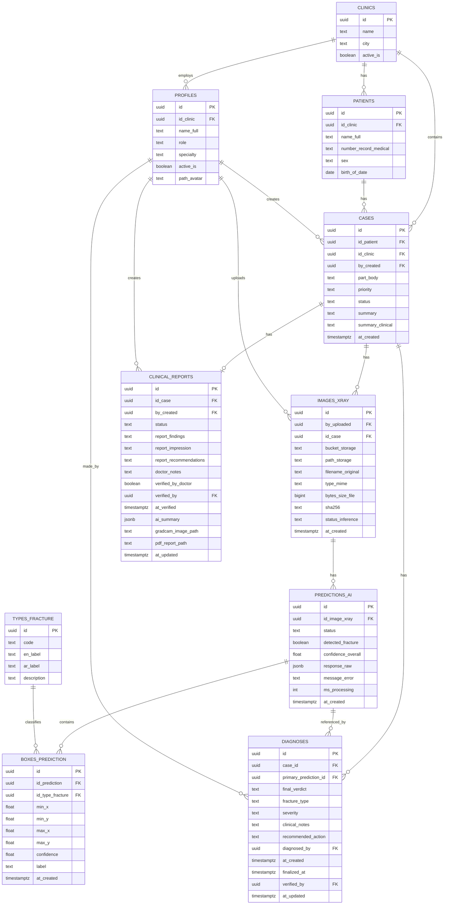

# PROJECT ARCHITECTURE AND DATABASE REFERENCE
## FractureAI Pro — Bone Fracture Detection System
### Quick Technical Reference Document

---

## 1. COMPLETE ARCHITECTURE REFERENCE

### 1.1 Architecture Type
**Hybrid Architecture** — combining:
- SPA (Single-Page Application) Frontend (React + Vite)
- Lightweight Express.js Backend Server (server.ts) for Gemini AI + static file serving
- Supabase Backend-as-a-Service (Auth, Database, Storage)
- Supabase Edge Function (Deno) for YOLO inference validation pipeline

### 1.2 Component Inventory

| Component | Technology | File(s) | Role |
|-----------|-----------|---------|------|
| Frontend SPA | React 19 + TypeScript + Vite | `frontend/` | UI rendering, state management |
| App Root | React | `frontend/App.tsx` | Routing, global state, auth orchestration |
| Express Server | Node.js + Express | `frontend/server.ts` | Hosts SPA, exposes Gemini AI endpoint |
| Supabase Client | @supabase/supabase-js | `frontend/lib/supabase.ts` | DB, Auth, Storage, Edge Functions |
| Auth Service | TypeScript class | `frontend/services/AuthService.ts` | Login, Register, Logout, Password Reset |
| Inference Service | TypeScript module | `frontend/services/inference.ts` | Calls `inference-run` Edge Function |
| Edge Function | Deno + TypeScript | `supabase/functions/inference-run/index.ts` | X-Ray validation, auth check, file verification |
| AI Engine (Python) | Python file | `ai_engine/inference.py` | **EMPTY — NOT IMPLEMENTED** |
| Supabase Auth | Supabase Auth | Supabase Cloud | JWT-based authentication |
| Supabase DB | PostgreSQL | Supabase Cloud | All relational data |
| Supabase Storage | Object Storage | Supabase Cloud bucket: `images-xray` | X-Ray file storage |

### 1.3 Technology Stack

| Layer | Technology | Version |
|-------|-----------|---------|
| Frontend Framework | React | 19.0.1 |
| Language | TypeScript | ~5.8.2 |
| Build Tool | Vite | 6.2.3 |
| Styling | TailwindCSS | 4.1.14 |
| Backend Server | Express.js | 4.21.2 |
| AI SDK | @google/genai (Gemini) | 2.4.0 |
| Database Client | @supabase/supabase-js | 2.116.0 |
| Edge Function Runtime | Deno | (Supabase managed) |
| Animation | Motion (Framer) | 12.23.24 |
| Icon Library | Lucide React | 0.546.0 |

---

## 2. DATABASE SCHEMA

### 2.1 Identified Tables (from source code analysis)

#### Table: `profiles`
*Source: `AuthService.ts`, `UploadModal.tsx`, `inference-run/index.ts`, `ProfileView.tsx`*

| Column | Data Type | Key | Description |
|--------|-----------|-----|-------------|
| id | UUID | PK, FK→auth.users | Supabase Auth user ID |
| id_clinic | UUID | FK→clinics | Assigned clinic |
| name_full | TEXT | | Full name |
| role | TEXT | | User role (technician, doctor, admin, etc.) |
| specialty | TEXT | NULL | Medical specialty |
| active_is | BOOLEAN | | Account active status (approval flag) |
| path_avatar | TEXT | NULL | Avatar image path |

#### Table: `clinics`
*Source: `AdminManagementView.tsx`, `inference-run/index.ts`*

| Column | Data Type | Key | Description |
|--------|-----------|-----|-------------|
| id | UUID | PK | Clinic ID |
| name | TEXT | | Clinic name |
| city | TEXT | NULL | City location |
| active_is | BOOLEAN | | Clinic active status |

#### Table: `patients`
*Source: `App.tsx`, `UploadModal.tsx`, `ReportModal.tsx`*

| Column | Data Type | Key | Description |
|--------|-----------|-----|-------------|
| id | UUID | PK | Patient ID |
| name_full | TEXT | | Patient full name |
| number_record_medical | TEXT | UNIQUE | Medical Record Number (MRN) |
| sex | TEXT | | Sex (Male/Female) |
| birth_of_date | DATE | NULL | Date of birth |
| id_clinic | UUID | FK→clinics | Clinic ownership |

#### Table: `cases`
*Source: `App.tsx`, `UploadModal.tsx`, `ReportModal.tsx`, `inference-run/index.ts`*

| Column | Data Type | Key | Description |
|--------|-----------|-----|-------------|
| id | UUID | PK | Case ID |
| id_patient | UUID | FK→patients | Linked patient |
| id_clinic | UUID | FK→clinics | Clinic context |
| by_created | UUID | FK→profiles | Creator user ID |
| part_body | TEXT | | Body part/region (e.g. Left Femur) |
| priority | TEXT | | Case priority (normal, urgent) |
| status | TEXT | | Case status |
| summary | TEXT | | Clinical summary text |
| summary_clinical | TEXT | NULL | Detailed clinical summary |
| at_created | TIMESTAMPTZ | | Creation timestamp |

#### Table: `images_xray`
*Source: `App.tsx`, `UploadModal.tsx`, `DetectView.tsx`, `inference-run/index.ts`, `ReportModal.tsx`*

| Column | Data Type | Key | Description |
|--------|-----------|-----|-------------|
| id | UUID | PK | Image record ID |
| by_uploaded | UUID | FK→profiles | Uploader user ID |
| id_case | UUID | FK→cases | Linked case |
| bucket_storage | TEXT | | Supabase Storage bucket name |
| path_storage | TEXT | | Storage file path |
| filename_original | TEXT | | Original file name |
| type_mime | TEXT | | MIME type (image/jpeg, etc.) |
| bytes_size_file | BIGINT | | File size in bytes |
| sha256 | TEXT | | SHA-256 hash of file |
| status_inference | TEXT | | Inference status: queued / processing / succeeded / failed |
| at_created | TIMESTAMPTZ | | Upload timestamp |

#### Table: `predictions_ai`
*Source: `App.tsx`, `ReportModal.tsx`*

| Column | Data Type | Key | Description |
|--------|-----------|-----|-------------|
| id | UUID | PK | Prediction ID |
| id_image_xray | UUID | FK→images_xray | Linked X-Ray image |
| status | TEXT | | succeeded / failed |
| detected_fracture | BOOLEAN | | Whether fracture was detected |
| confidence_overall | FLOAT | NULL | Overall confidence score (0..1) |
| response_raw | JSONB | | Raw AI model response |
| message_error | TEXT | NULL | Error message if failed |
| ms_processing | INTEGER | NULL | Processing time in milliseconds |
| at_created | TIMESTAMPTZ | | Prediction timestamp |

#### Table: `boxes_prediction`
*Source: `App.tsx`, `ReportModal.tsx`*

| Column | Data Type | Key | Description |
|--------|-----------|-----|-------------|
| id | UUID | PK | Box ID |
| id_prediction | UUID | FK→predictions_ai | Linked prediction |
| id_type_fracture | UUID | FK→types_fracture | NULL | Fracture type reference |
| min_x | FLOAT | | Bounding box left (normalized 0..1) |
| min_y | FLOAT | | Bounding box top (normalized 0..1) |
| max_x | FLOAT | | Bounding box right (normalized 0..1) |
| max_y | FLOAT | | Bounding box bottom (normalized 0..1) |
| confidence | FLOAT | | Box-level confidence score |
| label | TEXT | | Detection label string |
| at_created | TIMESTAMPTZ | | Timestamp |

#### Table: `types_fracture`
*Source: `App.tsx`*

| Column | Data Type | Key | Description |
|--------|-----------|-----|-------------|
| id | UUID | PK | Fracture type ID |
| code | TEXT | UNIQUE | Machine-readable code |
| en_label | TEXT | | English label |
| ar_label | TEXT | NULL | Arabic label |
| description | TEXT | NULL | Description |

#### Table: `clinical_reports`
*Source: `ReportModal.tsx`*

| Column | Data Type | Key | Description |
|--------|-----------|-----|-------------|
| id | UUID | PK | Report ID |
| id_case | UUID | FK→cases | Linked case |
| by_created | UUID | FK→profiles | Report author |
| status | TEXT | | draft / finalized |
| report_findings | TEXT | | Findings text |
| report_impression | TEXT | | Impression text |
| report_recommendations | TEXT | | Recommendations text |
| doctor_notes | TEXT | NULL | Doctor additional notes |
| verified_by_doctor | BOOLEAN | | Verification flag |
| verified_by | UUID | NULL | FK→profiles who verified |
| at_verified | TIMESTAMPTZ | NULL | Verification timestamp |
| ai_summary | JSONB | NULL | AI prediction summary snapshot |
| raw_image_path | TEXT | NULL | Path to raw image |
| annotated_image_path | TEXT | NULL | Path to annotated image |
| gradcam_image_path | TEXT | NULL | Path to Grad-CAM image |
| pdf_report_path | TEXT | NULL | Path to generated PDF |
| at_updated | TIMESTAMPTZ | | Last update timestamp |

#### Table: `diagnoses`
*Source: `ReportModal.tsx`, `DiagnosisModal.tsx`*

| Column | Data Type | Key | Description |
|--------|-----------|-----|-------------|
| id | UUID | PK | Diagnosis ID |
| case_id | UUID | FK→cases | Linked case |
| primary_prediction_id | UUID | NULL FK→predictions_ai | AI prediction this is based on |
| final_verdict | TEXT | | confirmed_fracture / no_fracture / uncertain |
| fracture_type | TEXT | NULL | Fracture classification |
| severity | TEXT | NULL | Severity assessment |
| clinical_notes | TEXT | NULL | Clinical notes |
| recommended_action | TEXT | NULL | Recommended clinical action |
| diagnosed_by | UUID | FK→profiles | Doctor who diagnosed |
| at_created | TIMESTAMPTZ | | Creation timestamp |
| finalized_at | TIMESTAMPTZ | NULL | Finalization timestamp |
| verified_by | UUID | NULL FK→profiles | Verifier |
| at_updated | TIMESTAMPTZ | | Last update timestamp |

### 2.2 Supabase Database Functions (RPCs)

| Function | Source | Purpose |
|----------|--------|---------|
| `patient_find_or_create` | `UploadModal.tsx` | Find existing or create new patient by name+sex |
| `case_create` | `UploadModal.tsx` | Create new case linked to patient |
| `admin_get_pending_users` | `AdminManagementView.tsx` | Get inactive users awaiting approval |
| `admin_get_clinics` | `AdminManagementView.tsx` | Get all clinics |
| `admin_approve_user` | `AdminManagementView.tsx` | Activate user and assign clinic |
| `diagnosis_case_finalize` | `DiagnosisModal.tsx` | Save final doctor diagnosis for case |

### 2.3 Storage Architecture

| Bucket | Purpose | Access Pattern |
|--------|---------|----------------|
| `images-xray` | X-Ray image files | Authenticated signed URLs (1-hour expiry) |

**Storage Path Pattern:** `{user_id}/{case_id}/{timestamp}-{sanitized_filename}`

**File Link in DB:** `images_xray.path_storage` + `images_xray.bucket_storage` → joined to generate signed URL via `supabase.storage.from(bucket).createSignedUrl(path, 3600)`

---

## 3. ER DIAGRAM

---

## 4. API INVENTORY

### 4.1 Express Server Endpoints (`frontend/server.ts`)

| Endpoint | Method | Auth | Input | Output | Purpose |
|----------|--------|------|-------|--------|---------|
| `GET /api/health` | GET | None | — | `{status, timestamp}` | Health check |
| `POST /api/analyze-scan` | POST | None (server-side key) | `{imageBase64, mimeType, patientInfo, modality, region}` | `{success, data: DiagnosticReport}` | Gemini AI scan analysis |

**Note:** The `/api/analyze-scan` endpoint uses the Google Gemini API (`gemini-3.6-flash`) to analyze X-Ray images and returns a structured JSON diagnostic report including primaryFinding, confidence, obbBox coordinates, recommendations, etc.

### 4.2 Supabase Edge Function (`supabase/functions/inference-run/index.ts`)

| Endpoint | Method | Auth | Input | Output | Purpose |
|----------|--------|------|-------|--------|---------|
| `POST /functions/v1/inference-run` | POST | Bearer JWT | `{id_image_xray: string}` | Validation result JSON | X-Ray validation pipeline |

**Current Status:** Validation-only. YOLO-OBB model execution is explicitly NOT enabled (comment in code, lines 437-444). Returns `model_execution_enabled: false`.

### 4.3 Supabase Client Operations (Direct SDK)

| Operation | Table/Method | File | Purpose |
|-----------|-------------|------|---------|
| `supabase.auth.signInWithPassword()` | Auth | `AuthService.ts:178` | User login |
| `supabase.auth.signUp()` | Auth | `AuthService.ts:272` | User registration |
| `supabase.auth.signOut()` | Auth | `AuthService.ts:383` | Logout |
| `supabase.auth.resetPasswordForEmail()` | Auth | `AuthService.ts:353` | Password reset |
| `supabase.auth.getUser()` | Auth | Multiple files | Get current user |
| `supabase.auth.getSession()` | Auth | `inference.ts:36` | Get active session token |
| `supabase.from('profiles').select()` | DB | `AuthService.ts:87` | Load user profile |
| `supabase.from('cases').select(...)` | DB | `App.tsx:596` | Load all cases with relations |
| `supabase.from('images_xray').insert()` | DB | `UploadModal.tsx:363` | Create X-Ray metadata record |
| `supabase.from('images_xray').select()` | DB | `DetectView.tsx:116` | Find latest X-Ray for case |
| `supabase.from('clinical_reports').select()` | DB | `ReportModal.tsx:338` | Load existing report |
| `supabase.from('clinical_reports').insert()` | DB | `ReportModal.tsx` | Create new report |
| `supabase.from('clinical_reports').update()` | DB | `ReportModal.tsx:674` | Update report draft |
| `supabase.from('predictions_ai').select()` | DB | `ReportModal.tsx:489` | Load AI prediction |
| `supabase.from('boxes_prediction').select()` | DB | `ReportModal.tsx:532` | Load bounding boxes |
| `supabase.from('diagnoses').select()` | DB | `ReportModal.tsx:406` | Load final diagnosis |
| `supabase.storage.from('images-xray').upload()` | Storage | `UploadModal.tsx:343` | Upload X-Ray file |
| `supabase.storage.from().createSignedUrl()` | Storage | `App.tsx:786`, `UploadModal.tsx:421` | Generate access URL |
| `supabase.storage.from().download()` | Storage | `inference-run/index.ts:376` | Download X-Ray for validation |
| `supabase.rpc('patient_find_or_create')` | RPC | `UploadModal.tsx:265` | Find/create patient |
| `supabase.rpc('case_create')` | RPC | `UploadModal.tsx:307` | Create case |
| `supabase.rpc('admin_get_pending_users')` | RPC | `AdminManagementView.tsx:54` | Admin: list pending users |
| `supabase.rpc('admin_get_clinics')` | RPC | `AdminManagementView.tsx:55` | Admin: list clinics |
| `supabase.rpc('admin_approve_user')` | RPC | `AdminManagementView.tsx:111` | Admin: approve user |
| `supabase.rpc('diagnosis_case_finalize')` | RPC | `DiagnosisModal.tsx:43` | Finalize doctor diagnosis |
| `supabase.functions.invoke('inference-run')` | Edge Function | `inference.ts:55`, `DetectView.tsx:160` | Trigger inference pipeline |

---

## 5. FRONTEND ROUTES AND PAGES

The application is a **Single-Page Application (SPA)** — all routing is state-based (`activeTab` state in `App.tsx`), not URL-based.

| Tab/View | State Value | Component File | Access |
|----------|-------------|----------------|--------|
| Splash Screen | (initial) | `screens/SplashScreen.tsx` | Public |
| Auth Layout (Login/Register/ForgotPw) | (unauthenticated) | `screens/AuthLayout.tsx` | Unauthenticated only |
| Login Page | 'login' sub-view | `screens/LoginPage.tsx` | Unauthenticated |
| Register Page | 'register' sub-view | `screens/RegisterPage.tsx` | Unauthenticated |
| Forgot Password | 'forgot_password' sub-view | `screens/ForgotPasswordPage.tsx` | Unauthenticated |
| Dashboard | 'dashboard' | `screens/DashboardView.tsx` | Authenticated |
| Detect / AI Analysis | 'detect' | `screens/DetectView.tsx` | Authenticated |
| AI Explanation | 'explain' | `screens/ExplainView.tsx` | Authenticated |
| Case History / Database | 'database' | `screens/DatabaseView.tsx` | Authenticated |
| Case Details | 'case-details' | `screens/CaseDetailsView.tsx` | Authenticated |
| Profile | 'profile' | `screens/ProfileView.tsx` | Authenticated |
| Admin Management | 'admin-management' | `screens/AdminManagementView.tsx` | Authenticated + Admin role |
| Upload Modal | (overlay) | `components/UploadModal.tsx` | Authenticated |
| Report Modal | (overlay) | `components/ReportModal.tsx` | Authenticated |
| Settings Modal | (overlay) | `components/SettingsModal.tsx` | Authenticated |
| Diagnosis Modal | (overlay) | `screens/DiagnosisModal.tsx` | Authenticated + Doctor/Admin |

---

## 6. COMPONENT INVENTORY

### Shared Layout Components

| Component | File | Role |
|-----------|------|------|
| `Sidebar` | `components/Sidebar.tsx` | Main navigation sidebar |
| `Header` | `components/Header.tsx` | Top header bar |
| `ToolsOverlay` | `components/ToolsOverlay.tsx` | Measurement/angle tools overlay |

### Modal Components

| Component | File | Role |
|-----------|------|------|
| `UploadModal` | `components/UploadModal.tsx` | X-Ray upload workflow (10-step) |
| `ReportModal` | `components/ReportModal.tsx` | Medical report creation/view |
| `SettingsModal` | `components/SettingsModal.tsx` | App settings |
| `DiagnosisModal` | `screens/DiagnosisModal.tsx` | Doctor final diagnosis form |

### Screen Components

| Component | File | Role |
|-----------|------|------|
| `SplashScreen` | `screens/SplashScreen.tsx` | App loading screen |
| `AuthLayout` | `screens/AuthLayout.tsx` | Authentication container |
| `LoginPage` | `screens/LoginPage.tsx` | Email/password login form |
| `RegisterPage` | `screens/RegisterPage.tsx` | New account registration form |
| `ForgotPasswordPage` | `screens/ForgotPasswordPage.tsx` | Password reset request |
| `DashboardView` | `screens/DashboardView.tsx` | Statistics and recent scans |
| `DetectView` | `screens/DetectView.tsx` | AI detection viewer + analysis trigger |
| `ExplainView` | `screens/ExplainView.tsx` | AI explanation visualization |
| `DatabaseView` | `screens/DatabaseView.tsx` | Case history with filters |
| `CaseDetailsView` | `screens/CaseDetailsView.tsx` | Individual case details |
| `ProfileView` | `screens/ProfileView.tsx` | User profile display |
| `AdminManagementView` | `screens/AdminManagementView.tsx` | Pending user approval, clinic assignment |

---

## 7. TECHNICAL EVIDENCE MATRIX

| Technical Claim | Evidence File | Function/Component | Verification Status |
|-----------------|-------------|-------------------|---------------------|
| React + TypeScript SPA architecture | `frontend/package.json`, `frontend/vite.config.ts` | — | VERIFIED |
| Express.js server hosts SPA and Gemini API | `frontend/server.ts:10,37` | `startServer()` | VERIFIED |
| Gemini 3.6 Flash model used for AI analysis | `frontend/server.ts:81` | `app.post('/api/analyze-scan')` | VERIFIED |
| Supabase Auth via signInWithPassword | `frontend/services/AuthService.ts:178` | `AuthService.login()` | VERIFIED |
| Account approval workflow (active_is flag) | `frontend/services/AuthService.ts:133` | `validateProfile()` | VERIFIED |
| "Remember Me" session persistence | `frontend/lib/supabase.ts:22-61` | `authStorage` | VERIFIED |
| X-Ray upload to Supabase Storage bucket `images-xray` | `frontend/components/UploadModal.tsx:333-355` | `handleAnalyze()` | VERIFIED |
| Storage path pattern: `userId/caseId/timestamp-filename` | `frontend/components/UploadModal.tsx:101-111` | `generateStoragePath()` | VERIFIED |
| SHA-256 file hash computed before upload | `frontend/components/UploadModal.tsx:82-91` | `calculateSha256()` | VERIFIED |
| `patient_find_or_create` RPC called on upload | `frontend/components/UploadModal.tsx:265` | `handleAnalyze()` | VERIFIED |
| `case_create` RPC called on upload | `frontend/components/UploadModal.tsx:307` | `handleAnalyze()` | VERIFIED |
| `inference-run` Edge Function invoked | `frontend/services/inference.ts:55` | `runInference()` | VERIFIED |
| Edge Function validates user auth | `supabase/functions/inference-run/index.ts:56-91` | Deno.serve handler | VERIFIED |
| Edge Function validates image ownership | `supabase/functions/inference-run/index.ts:222-231` | Deno.serve handler | VERIFIED |
| Edge Function validates clinic access | `supabase/functions/inference-run/index.ts:338-352` | Deno.serve handler | VERIFIED |
| Edge Function downloads file to verify it exists | `supabase/functions/inference-run/index.ts:372-396` | Deno.serve handler | VERIFIED |
| YOLO-OBB model NOT connected — validation only | `supabase/functions/inference-run/index.ts:437-444` | Deno.serve handler (comment) | VERIFIED |
| ai_engine/inference.py is EMPTY | `ai_engine/inference.py` | — | VERIFIED (file is empty) |
| Bounding boxes stored as normalized coordinates | `frontend/App.tsx:471-480` | `mapCaseToScanRecord()` | VERIFIED |
| OBB box rendering in DetectView | `frontend/screens/DetectView.tsx:420-443` | `DetectView` JSX | VERIFIED |
| Heatmap shown as CSS radial gradient (not real Grad-CAM) | `frontend/screens/DetectView.tsx:404-417` | `DetectView` JSX | VERIFIED |
| Clinical reports stored in `clinical_reports` table | `frontend/components/ReportModal.tsx:338-395` | `loadReportData()` | VERIFIED |
| Diagnoses stored in `diagnoses` table | `frontend/components/ReportModal.tsx:406-447` | `loadReportData()` | VERIFIED |
| `diagnosis_case_finalize` RPC finalizes diagnosis | `frontend/screens/DiagnosisModal.tsx:43` | `handleSaveDiagnosis()` | VERIFIED |
| Admin approval via `admin_approve_user` RPC | `frontend/screens/AdminManagementView.tsx:111` | `approveUser()` | VERIFIED |
| Signed URLs expire in 1 hour | `frontend/App.tsx:794`, `frontend/components/UploadModal.tsx:425` | `loadCases()`, `handleAnalyze()` | VERIFIED |
| Real Grad-CAM generation | — | — | NOT FOUND |
| YOLO-OBB inference execution | — | — | NOT FOUND (explicitly disabled) |
| Python backend integration | `ai_engine/inference.py` | — | NOT FOUND (file empty) |
| Row Level Security policies | — | Supabase Cloud (not in local files) | REQUIRES CONFIRMATION |
| PDF report generation | `ReportModal.tsx:663` (field placeholder) | `pdf_report_path` column | PARTIALLY VERIFIED (column exists, generation NOT implemented) |
